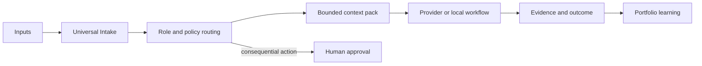

# ABVX-OS

**A local-first control plane for a personal AI operating system.**

[](https://github.com/markoblogo/ABVX-OS/actions/workflows/ci.yml)
[](https://github.com/markoblogo/ABVX-OS/actions/workflows/agentsgen-pr-guard.yml)
[](https://github.com/markoblogo/ABVX-OS/releases)
[](https://www.python.org/)
[](LICENSE)

ABVX-OS turns projects, opportunities, evidence, professional roles, and approval rules into inspectable local state. It helps a human and AI tools decide what context to load, which specialist stance to use, what may run, and where a human decision is required.

It is an active reference implementation and the maintainer's working system. The reusable core is intentionally dependency-light; personal records and publishing artifacts remain data, not a required runtime.

## See it work

```sh
git clone https://github.com/markoblogo/ABVX-OS.git
cd ABVX-OS
./bin/abvx --version
./bin/abvx validate
./bin/abvx role route --text "Research a market and prepare a book brief" --json
./bin/abvx portfolio inspect
```

The first three commands are read-only. `validate` checks the versioned schemas, registries, fixtures, evidence, and operating contracts. Role routing is deterministic and grants no tools or authority. See the [five-minute quick start](docs/QUICKSTART.md) before using commands that change local state.

## What is implemented

| Capability | Current behavior |
| --- | --- |
| Universal Intake | Classifies, clarifies, reviews, links, and idempotently promotes local inputs |
| Professional roles | Selects one primary specialist and up to two supporting roles |
| Portfolio state | Keeps strategy, operational state, lessons, and the human review queue inspectable |
| Context bridge | Produces bounded `ContextRequest -> ContextPack` retrieval across approved stores |
| Book Radar and publishing gates | Four-market evidence adapters, independent qualification, immutable learning/method records, outcome attribution and publishing gates; browser acquisition remains separate |
| Book readiness | Incremental deterministic inventory with separate rights, overlap, readiness and commercial evidence |
| Local Mac monitoring | User LaunchAgent every five minutes, native diagnostics, separate manual/background history, workflow freshness, incident alerts, owner-authorized bounded cache cleanup and research handoffs; Telegram unconnected |
| Maintenance | Read-only dirty-tree classification and synthetic-data isolation checks |
| Cortex process learning | Explicit private outcome export and review-only, evidence-bound optimization candidates |
| Playbooks and bakeoffs | Replays proven routines and compares providers with retained evidence |



## Operating principles

- Projects remain deployable and useful when ABVX-OS is unavailable.
- Evidence, provenance, and explicit ownership come before automation.
- Reuse internal capabilities and qualify external capabilities before building.
- Check donor options and prefer thin wrappers/configuration before custom subsystems.
- Treat token/model capacity as a constrained portfolio resource, not an unlimited platform budget.
- Prefer a small modular monolith and local state until scale proves otherwise.
- Automation is bounded by source/action policy and human approval gates.
- Minimize dependencies, cost, secrets, and generated state.

## Product boundary

ABVX-OS owns local contracts, policy, provenance, decisions, and evidence. Projects remain independently deployable. Providers remain replaceable. Consequential external actions require the applicable policy and approval gate. The repository is not a general workflow engine, autonomous production executor, or SaaS control plane.

## Documentation

- [Quick start](docs/QUICKSTART.md) — safe first commands and state-changing boundaries
- [Architecture](ARCHITECTURE.md) — ownership, trust domains, providers, and failure isolation
- [Product vision](docs/product-vision.md) — why this is a Personal Operator rather than a task manager
- [Professional role routing](docs/professional-role-routing.md) — specialist selection without authority escalation
- [Ecosystem](docs/ECOSYSTEM.md) — contracts with ID, agentsgen, SET, and ABVX Agent Skills
- [Book systems learning](ABVX_BOOK_SYSTEMS_LEARNING_V1.md) — append-only learning across Radar, fiction, Toki Pona, and Pictiq experiments
- [Roadmap](docs/roadmap.md) and [changelog](CHANGELOG.md)

For a fresh agent session, follow the compact read order in [AGENTS.md](AGENTS.md) and load deeper documents only when the task requires them.

See [repository hygiene and release checks](docs/maintenance/REPOSITORY_HYGIENE_V1.md) before committing an accumulated owner workspace. New manuscripts, research observations, account/security inventories and generated media stay local. Existing historical public artifacts are not erased by `.gitignore` or removed from Git history by this maintenance pass.

## Development

ABVX-OS keeps its core CLI dependency-light. Book Core and Book Radar's observed-outcome contracts use the exact-pinned Draft 2020-12 `python-jsonschema` runtime and dependency closure listed in `requirements-dev.txt`.

```sh
python3 -m pip install -r requirements-dev.txt
PYTHONPATH=src python3 -m unittest discover -s tests -q
./bin/abvx validate
```

Contributions should preserve project independence, schema compatibility, human gates, and evidence-backed claims. See [CONTRIBUTING.md](CONTRIBUTING.md) and [SECURITY.md](SECURITY.md).

## Licensing

Source code and machine-readable schemas are available under the [MIT License](LICENSE). Books, manuscripts, generated publication files, personal operational records, and project evidence are excluded from that grant unless a file says otherwise; see [CONTENT-LICENSE.md](CONTENT-LICENSE.md).

## Maintenance and Cortex learning

[Development checks](docs/development-checks.md) provide one repeatable local check using a selected isolated Python environment. `./bin/maintain inspect` inventories unfinished work without deleting or publishing it. [OS/Cortex milestones](docs/maintenance/OS_CORTEX_MILESTONES_V1.md) distinguish implementation, real admission/retrieval and independently measured benefit.

`./bin/abvx learning record-check isolated-books --out .tmp/os-learning/new-run.json` records a fresh read-only run. Explicitly selected outcomes can then be exported for protected admission in the independent Cortex ABV runtime; no manuscript, customer text or credentials enter the telemetry contract. Cortex retrieves relevant outcomes and diagnoses missing measurements before any optional installed-local-model trial suggestion. `learning inspect-candidate` and `learning inspect-proposal` validate return evidence and grant no execution authority. Use the selected environment described in the development guide.

Real history, model suggestions and proof logs remain ignored; tests use frozen synthetic fixtures. Business 1D3X Cortex remains independent of OS and retains its project-owned deployment and data gates. The private runtime owns the detailed operator contract; no public/private snapshot synchronization or unattended agent is enabled by this bridge.

## Native publication learning

After explicit ABVX.xyz publication authorization, start one private cycle before preparation/intake. Singles and frozen pools produce one independent observation each; v2 measures first-work-after-command to verified production, preserving owner effort UNKNOWN. Match all member approvals, passing checks and the exact deployed merge SHA before transferring numeric evidence to independent Cortex; change one optimization at a time. Legacy/book effort gates remain unchanged. See [the operator guide](docs/maintenance/PUBLICATION_LEARNING_CYCLE_V1.md). RSS-only imports and automatic book lifecycle capture are outside this release.

## Prepared book and business exchange rules

[Book and business Cortex rules](docs/maintenance/BOOKS_BUSINESS_EXCHANGE_RULES_V1.md) define a first-real-publication acceptance gate, phase-scoped book outcomes and separate business supervision. Preparation grants no runtime activation; book capture and business transport are later bounded pilots. Explicit first-cycle verification retains deployed-merge-SHA proof; the book export profile guards count, phase and workload before handoff.

## Native publication check profiles

Native ABVXsite publications use the Git-verified six-gate `publication-v1` profile; code changes or unknown scope retain eight full gates. OS verifies member coverage and hashes the selected check/QA tier into comparable evidence. Use the read-only site readiness helper, then close the existing cycle immediately after verified production. See [the publication learning cycle](docs/maintenance/PUBLICATION_LEARNING_CYCLE_V1.md#owner-authorized-publication-qa-profile-v1).

Standard ABVXsite posts and cases follow the [data-only publication boundary](docs/maintenance/PUBLICATION_LEARNING_CYCLE_V1.md#routine-publication-boundary): one approved packet/pool, separate engineering changes, unchanged production and Cortex evidence.

## Local Mac operator

The owner installed `xyz.abvx.mac-operator` as a user LaunchAgent. A real background invocation completed with exit code 0 and all diagnostic probes available. It samples every five minutes without LLM calls. Internal macOS disk capacity is primary; repository-volume capacity is secondary. It does not run while the Mac sleeps or before user login after reboot.

Use `./bin/mac-operator status`, `services`, or `cleanup` (preview only). Remote Telegram control is prepared but not connected; weekly research still uses the existing Codex/browser playbooks. Local incident notifications are submitted to macOS; visible delivery is unverified. Research commands create deduplicated handoffs, with automatic Codex dispatch still blocked. Owner-authorized fixed-cache cleanup is enabled for 30 days, below 15 GiB free, at most every six hours and 2 GiB/day; active or uninspectable caches are skipped. The monitor does not imply unattended research, general-purpose deletion or verified crash recovery. See [setup, stop and limitations](docs/maintenance/MAC_OPERATOR_V1.md) and [process integration review](docs/maintenance/LOCAL_OPERATIONS_INTEGRATION_V1.md).

## Каталог возможностей / Nantes Radar

[Единый каталог возможностей](docs/OPPORTUNITIES.md) объединяет вакансии, платформы, творческие заявки и клиентские проекты. Вход: `./bin/abvx opportunities catalog`. Поиск, приватные профили, черновики, ручные решения и импорт истории ChatGPT; без автоматической отправки и новых уведомлений.
